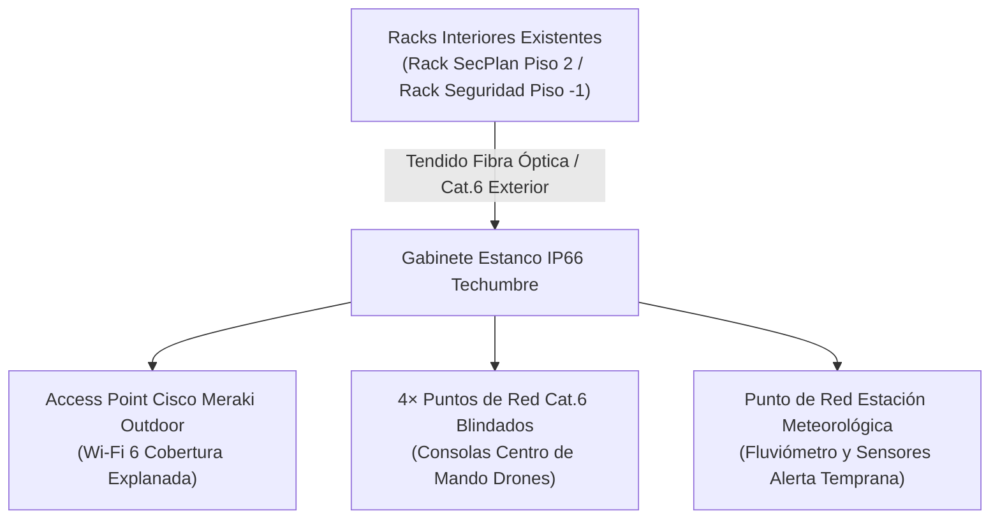
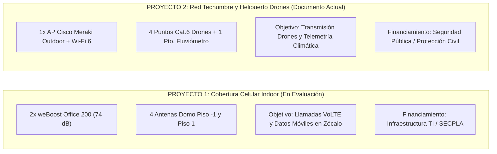

# Proyecto Independiente: Conectividad de Red Exterior, Wi-Fi Outdoor y Centro de Mando de Drones en Techumbre

**Institución:** Ilustre Municipalidad de Pedro Aguirre Cerda  
**Dependencia:** Centro Consistorial — Av. Presidente Salvador Allende N° 2029  
**Áreas Municipales Involucradas:** Depto. de Informática (SECPLA) · Dirección de Seguridad Ciudadana / Protección Civil y Emergencias  
**Integrador Tecnológico:** Tecnovoa Ltda. (`www.tecnovoa.cl` — Providencia, Santiago)  
**Documento Técnico Independiente — Versión 1.0 (Octubre 2026)**  

> [!NOTE]
> **Propósito de este Documento:**  
> Este proyecto se separa intencionalmente del proyecto de **Amplificación de Señal Celular In-Building (2× weBoost Office 200)** con el fin de evitar confusiones operativas, separar fuentes de financiamiento presupuestario y tramitar cada requerimiento por su propia vía técnica y administrativa en Mercado Público / SECPLA.

---

## 🎯 1. Resumen Ejecutivo y Origen del Requerimiento

Durante el levantamiento técnico en terreno realizado en el Centro Consistorial, se identificó una iniciativa estratégica impulsada por la Dirección de Seguridad Ciudadana y el Área de Gestión del Riesgo y Desastres: **la habilitación de un centro de operación de aeronaves remotamente tripuladas (drones de vigilancia comunal) y una estación meteorológica comunal en la azotea del edificio municipal**.

Para viabilizar este centro de mando en altura, se requiere dotar a la cubierta del edificio de **conectividad de red cableada certificada y cobertura inalámbrica Wi-Fi Outdoor de estándar empresarial**, independizándolo de las redes de telefonía móvil celular.

---

## 🏢 2. Alcance Técnico Específico

### 2.1. Conectividad Inalámbrica Exterior (Wi-Fi Outdoor)
* **Objetivo:** Brindar cobertura Wi-Fi de alta densidad y baja latencia en toda la explanada superior de la techumbre para el desplazamiento libre de los pilotos y operadores de drones.
* **Equipamiento Propuesto:** 
  * **1 Access Point Cisco Meraki Outdoor (Serie MR76 o MR86):** Equipo con certificación **IP67 para intemperie**, resistente a radiación UV, lluvia torrencial y rango térmico extendido (-40°C a +55°C).
  * **Integración al Dashboard Municipal:** El punto de acceso se aprovisiona dentro del mismo portal en la nube de Cisco Meraki administrado actualmente por el Depto. de Informática, manteniendo las mismas políticas de seguridad, VLANs segregadas (Operaciones, Drones, Invitados) y autenticación corporativa.
  * **Antenas Omnidireccionales Outdoor Dual-Band:** Para cobertura 360° en las bandas de 2,4 GHz y 5 GHz (Wi-Fi 6).

### 2.2. Centro de Control y Helipuerto de Drones (Seguridad Comunal)
* **Flota Operativa:** Proyecto diseñado para dar soporte a la flota municipal de **hasta 4 drones** operando de manera coordinada.
* **Puntos de Red Cableados (4× Cat.6 Exterior Blindado F/UTP):**
  * Habilitación de 4 tomas de red RJ-45 en pedestales o cajas estancas en la zona de despegue/aterrizaje.
  * Conexión directa para las estaciones base de control en tierra (GCS - Ground Control Stations), permitiendo transmisión en vivo de streaming de video HD hacia el **Video Wall de Seguridad Ciudadana en el Piso -1** sin latencia ni saturación de espectro radioeléctrico.

### 2.3. Telemetría Estación Meteorológica (Alerta Temprana Comunal)
* **Objetivo:** Conexión permanente IP para la estación de monitoreo climático y fluviómetro comunal.
* **Alcance:** 1 punto de red cableado Cat.6 intemperie con PoE (Power over Ethernet) para energizar y transmitir datos pluviométricos y barométricos al centro comunal de incidentes.

---

## 🛠️ 3. Infraestructura Física y Canalizaciones

| Componente | Especificación Técnica | Función |
| :--- | :--- | :--- |
| **Punto de Origen** | Rack SecPlan (Piso 2) o Rack Seguridad (Piso -1) | Conexión a Switch PoE+ corporativo |
| **Canalización Vertical** | Tubería Conduit metálica galvanizada (EMT/cag) de 1" exterior con sellos cortafuego | Salida limpia a techumbre por pasadas existentes |
| **Cableado** | Cable Cat.6 F/UTP con doble chaqueta PE exterior resistente a rayos UV | Protección contra intemperie e inducción |
| **Protección Eléctrica** | Protectores de sobretensión Ethernet PoE (Gas Discharge Tube) con bajada a tierra | Protección de switches interiores contra descargas atmosféricas |
| **Gabinete Exterior** | Gabinete metálico o poliéster IP66 NEMA 4X con cerradura antivandálica | Punto de distribución y parcheo en azotea |

---

## 📋 4. Lista de Materiales Estimada (BOM Red Techumbre)

1. **Equipamiento Activo:**
   * 1× Access Point Cisco Meraki Outdoor (MR76 o MR86) con kit de montaje a mástil.
   * 1× Licencia Cisco Meraki Enterprise Cloud (1, 3 o 5 años según estándar municipal).
   * 2× Antenas Meraki Dual-Band Omni Outdoor (MA-ANT-20).
2. **Conectividad Pasiva y Cableado:**
   * 200 m Cable de Red Cat.6 F/UTP Outdoor doble chaqueta UV.
   * 5× Protectores de Sobretensión PoE Gigabit Ethernet para riel DIN / pared.
   * 1× Gabinete Mural Estanco IP66 (400×300×200 mm) con placa de montaje.
   * 4× Cajas estancas sobrepuestas IP65 con conectores RJ-45 estancos tipo rosca.
3. **Servicios de Instalación:**
   * Tendido y canalización en tubería galvanizada desde Rack Piso 2/Piso -1 hasta techumbre.
   * Conectorización, rotulación y certificación de puntos de red con analizador Fluke Networks.
   * Integración, configuración de SSIDs y alta de licencias en el portal Dashboard Cisco Meraki.

---

## 🔄 5. Independencia Respecto al Proyecto de Señal Celular

* **Presupuestos Separados:** Permite que Seguridad Ciudadana postule o asigne fondos específicos de prevención del delito / desastres para el centro de drones, sin comprometer el presupuesto de corrientes débiles de Informática destinado al repetidor celular.
* **Tiempos de Ejecución Autónomos:** La habilitación de las antenas celulares en los postes existentes de `3,5 m` puede ejecutarse de inmediato sin esperar la definición del centro de drones.
* **Sin Interferencia de Frecuencias:** La red Wi-Fi opera en 2,4 GHz / 5 GHz / 6 GHz (estándar 802.11ax), mientras que el sistema celular amplifica 700 / 850 / 1900 / AWS MHz con cables coaxiales apantallados de 50 Ω, garantizando compatibilidad electromagnética absoluta.

---

*Documento técnico emitido por **Tecnovoa Ltda.** como complemento de ingeniería para la Ilustre Municipalidad de Pedro Aguirre Cerda.*
